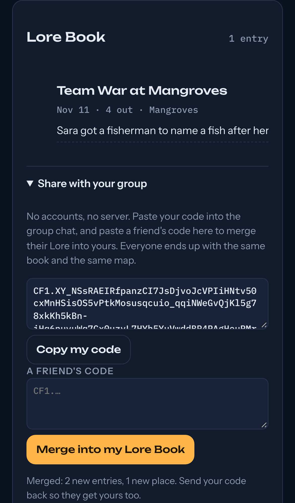

# Campfire

**Serverless sync for a small group's shared journal.** No accounts, no backend, no app store. Each friend's phone keeps its own copy, and you sync by pasting a code into the group chat. However many times, in whatever order, everyone ends up with the same journal.

Campfire is the sync layer behind [Lore](../lore)'s shared Lore Book.



## The idea

Friend groups don't want to sign up for things. They already have a group chat. If the whole journal fits in a message, that chat *is* the sync server. The hard part is merging: two people edit offline, then swap codes in either order, and nothing may get lost or conflict.

That's what a **CRDT** (conflict-free replicated data type) guarantees. Campfire implements a small state-based one from first principles:

| Part of the journal | CRDT | Rule |
|---|---|---|
| Entries | map of write-once records | an id is created once and never changes |
| Each entry's note | last-writer-wins register | later Lamport time wins; ties go to the higher replica id, then the value |
| Each entry's "deleted" flag | last-writer-wins register | same |
| Places explored | grow-only set | union |
| Clock | Lamport clock | a write stamps `clock + 1`; merge takes the max |

`merge(a, b)` is a join (commutative, associative and idempotent), which is exactly the condition for every replica to converge.

## Sync codes

```
CF1.<base64url(deflate(json))>.<crc32>
```

| Journal | JSON | Sync code |
|---|---|---|
| 1 entry | 304 chars | 291 chars |
| 10 entries | 2,675 chars | 552 chars |
| 50 entries | 13,208 chars | 1,529 chars |
| 100 entries | 26,240 chars | 2,636 chars |

*(Measured with notes of similar wording, which compress well. Varied real notes will produce longer codes.)*

A pasted code is **untrusted input**, so `decode()`:
- verifies the CRC-32 checksum, so truncated or edited codes are refused with a clear message
- stops inflating at 512 KB (zip-bomb guard)
- validates every field: id and replica formats, string lengths, types, integer clocks, and entry and place counts
- rebuilds the state from checked fields only, so unknown fields and `__proto__` keys never get through

## How it's verified

`npm test` runs 13 tests:
- **Merge laws on 400 random cases each:** commutativity, associativity and idempotence, on states produced by random histories of adds, note edits, deletes, explores and partial syncs across 3 replicas.
- **Convergence on 400 random cases:** 2 to 5 replicas with random histories gossip in a random order, and every replica ends up deep-equal.
- **No loss:** after syncing, every entry and place any replica ever had is still there.
- **Semantics:** a later edit wins, ties resolve the same from either side, a delete hides the entry everywhere, and writes never mutate.
- **Codes:** round trip, two-phone swap, 100 entries under 8,000 characters, damaged and truncated codes, a zip bomb, hostile fields, and unknown fields being dropped.

Lore adds an end-to-end test: two separate browser profiles, one finishes a quest and shares its code, the other pastes it and gets the entry and the cleared map.

## Use it

```js
import { emptyState, newReplicaId, addEntry, setNote, explore, merge, visibleEntries } from "campfire";
import { encode, decode } from "campfire/code";

const me = newReplicaId();
let book = addEntry(emptyState(), me, `${me}-1`, { title: "The Mina Draft", meta: "Nov 11 · 4 out", created: Date.now() });
const code = await encode(book);                     // paste this in the chat
book = merge(book, await decode(friendsCode));        // and merge theirs
```

For single-file apps, `node tools/bundle.js path/to/app.html` inlines Campfire between `/* campfire:start */` and `/* campfire:end */` markers, so the library stays the one source of truth. That's how Lore includes it.

## Limits, on purpose

- Codes carry the **whole** state, which is simple and robust for a friend group's journal (hundreds of entries). A larger dataset would want delta sync.
- Last-writer-wins on notes means two people editing the same note at once keep one version, not a merge of both. For one-line notes that's the right trade. Long shared text would need a sequence CRDT.
- Codes aren't encrypted. They're as private as the chat you paste them into.

## References

- M. Shapiro, N. Preguiça, C. Baquero, M. Zawirski. *Conflict-free Replicated Data Types.* SSS 2011.
- L. Lamport. *Time, Clocks, and the Ordering of Events in a Distributed System.* CACM 1978.
- M. Kleppmann et al. *Local-First Software: You Own Your Data, in Spite of the Cloud.* Onward! 2019.

## License

MIT. See [LICENSE](LICENSE).
