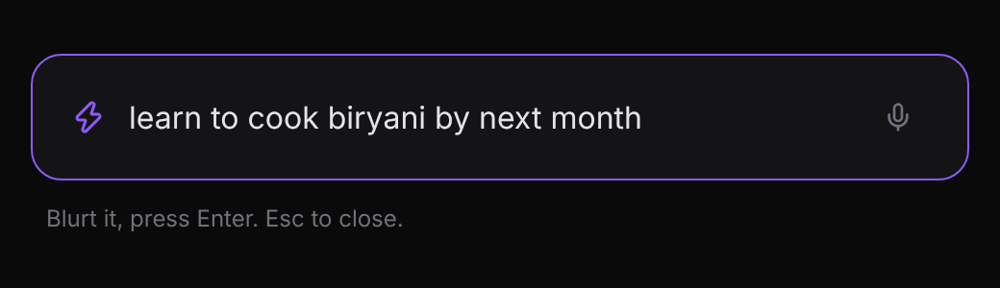
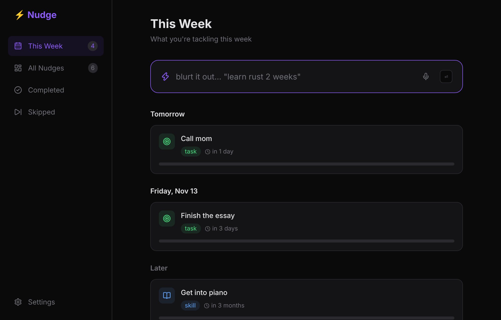
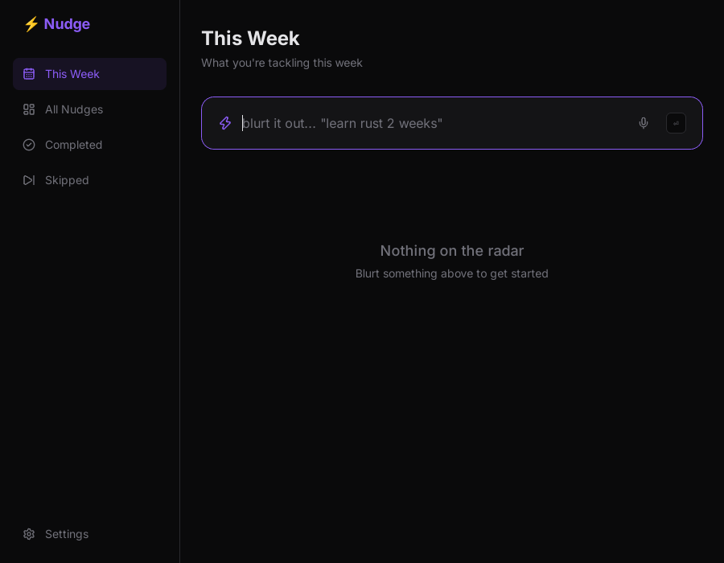

# Donna

A brain-dump app that lives in your system tray. Press `Option + D` from any app, type whatever you're thinking ("learn rust 2 weeks"), press Enter, and it disappears. Donna turns the thought into a titled, categorised goal with a deadline, plans it into your week, and checks in at 25%, 50%, 75% and 100% of the time you gave yourself, getting firmer each time.

<p>
  <br>
  
</p>

<p><br><em>The native Tauri build, compiled from this repo and running on Linux.</em></p>

## Why

Ideas, skills to learn and side projects get thought about once and then forgotten. Todo apps are too heavy to open in the moment, and reminders are easy to dismiss. Donna is built to be the fastest place to put a thought, and the most persistent about following up on it.

## What it does

- **An orb, not a window:** Donna is silent until she isn't. `Option + D` wakes a small circle in the bottom-right corner; type into it and it grows only as far as it needs to, then shrinks back. Esc sends it away.
- **Tell her, she plans it:** type what you're thinking into the panel and a local model (Gemma 4 12B via [Ollama](https://ollama.com), nothing leaves the machine) books it. A one-off with a time is just booked, a weekly thing becomes a fixed slot, and a goal gets two questions (minutes a day, deadline), then a session every day until it's due. Every tool argument the model sends is validated before it touches the plan.
- **Pushes back:** ask for something fun while a deadline is due today (or slipped yesterday) and Donna refuses until you say yes. Older misses don't block; they're backlog. The refusal is enforced in code (`src/lib/pushback.js`) and spoken verbatim, so the model can't book around it or claim it did.
- **Understands loose input:** "i wanna learn rust in 2 weeks" becomes **Learn rust**, *skill*, due in 14 days. Slang is normalized first with your [Idiolect](../idiolect) profile, so "lowk wanna learn rust jus 2 wks" works too. Timeframes use whole-word units, so "buy 3 more eggs" stays a title and is never read as "3 months".
- **Plans your week:** goals are grouped into overdue, each of the next 7 days, and later, each with a progress bar.
- **Reminders before a session, not after:** sessions have real clock times, so five minutes before one starts Donna says so — and the panel appears *unfocused*, so it never swallows what you're typing in another app.
- **Check-ins that escalate:** for anything not yet given a time — gentle at 25%, firm at 50% and 75%, urgent at the deadline. If your laptop slept through several, you get one nudge, the latest, not a burst.
- **Missed it? It's tomorrow's problem, first thing:** an end-of-day sweep moves anything you missed to the earliest free slot the next day and flags it as backlog.
- **Runs in the background:** closing the main window hides it to the tray so nudges keep arriving.

## Architecture

| Layer | Tech |
|---|---|
| Desktop shell | **Tauri 2** (Rust): tray icon, global shortcut plugin, notification plugin, about 10 MB instead of Electron's 150 MB |
| Permissions | Tauri capabilities: windows may only show, hide, focus and send notifications |
| UI | React 19, Vite, Tailwind CSS |
| Logic | `src/lib/planner.js` (Donna's tools and turn loop), `src/lib/ollama.js` (local model client), `src/lib/pushback.js` (refuse-until-confirmed), `src/lib/parser.js` (blurt to goal), `src/lib/schedule.js` (free slots and clashes), `src/lib/reminders.js` (what's about to start), `src/lib/backlog.js` (end-of-day rollover), `src/lib/nudges.js` (deadline check-ins) — all pure and unit tested |
| Storage | `localStorage`, synced live between the capture popup and the main window via the `storage` event |

The side panel is the same web app loaded with `?view=panel`, so there's one codebase for both windows. The panel is anchored to the right edge in Rust (`anchor_right`), because only the native side knows where the screen ends.

## Getting started

```bash
ollama pull gemma4:12b  # Donna's brain; `ollama serve` must be running
npm install
npx playwright install chromium   # once, for the end-to-end tests
npm run dev            # browser version at http://localhost:1420
npm test               # unit + end-to-end tests (Playwright)
```

Desktop app ([Rust](https://rustup.rs) and the [Tauri prerequisites](https://tauri.app/start/prerequisites/) for your OS):

```bash
npm run tauri dev
npm run tauri build    # installers in src-tauri/target/release/bundle
```

## Tests

180 tests (165 unit, 15 end-to-end), written test-first. Each parser bug got a failing test before its fix:
- **Parser:** timeframes (minutes to months, "tomorrow", "next week"), numbers that aren't timeframes, filler removal ("i wanna ... in"), whole-word categories ("walk the **dog**" is a habit, not a task because of "do"), and effort.
- **Idiolect port:** the JavaScript normalizer must reproduce the Python reference exactly on 27 exported conformance vectors (including Arabic and emoji). With the profile, "lowk wanna learn rust jus 2 wks" becomes **Learn rust**; without it the title would be "Lowk wanna learn rust jus".
- **Check-ins:** nothing due early, one due after the last check, only the latest after a long sleep, done and skipped items stay quiet.
- **Planner:** tool calls run and feed back, a blocked booking is answered with the guard's own words, malformed dates, times, lengths and weekdays from the model are rejected, and the prompt carries the local clock time and local deadlines.
- **End to end in Chromium:** a blurt becomes a categorised card, a check-in that came due fires exactly one notification, the This Week count matches the planner, the panel stays responsive while Donna thinks (Ollama stubbed), and with Ollama down the panel says how to fix it.

CI (`.github/workflows/ci.yml`) runs the tests, then builds the desktop app on Linux, macOS and Windows.

## Roadmap

- [x] Tray icon, capture-only popup and a Tauri 2 build
- [x] Native notifications on the check-in schedule
- [ ] Sync across phone and laptops
- [x] Use [Idiolect](../idiolect) to normalize slang before parsing (JavaScript port, checked against the Python reference)
- [ ] Voice capture
- [ ] "Snooze until tonight" and "mark done" actions on the notification itself

## License

MIT. See [LICENSE](LICENSE).
