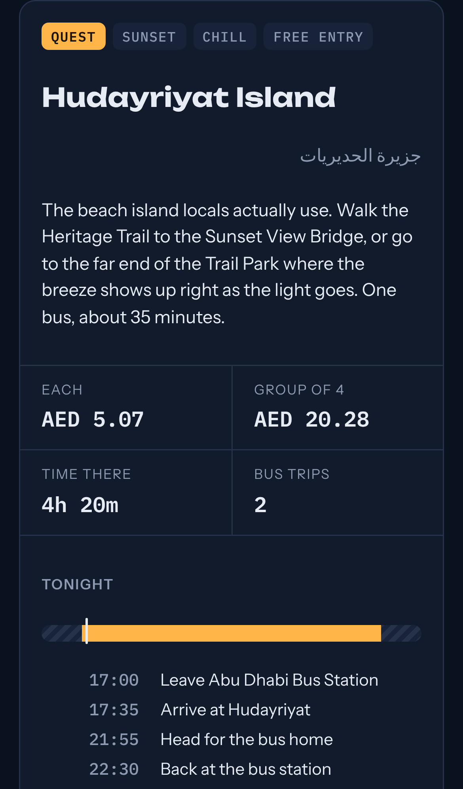
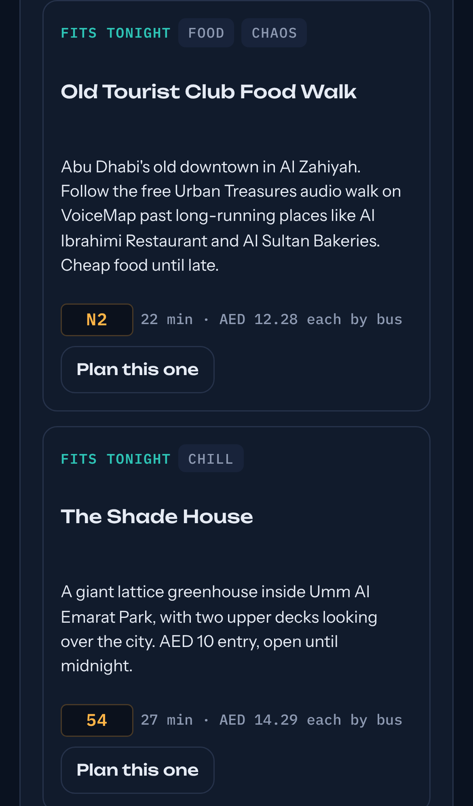
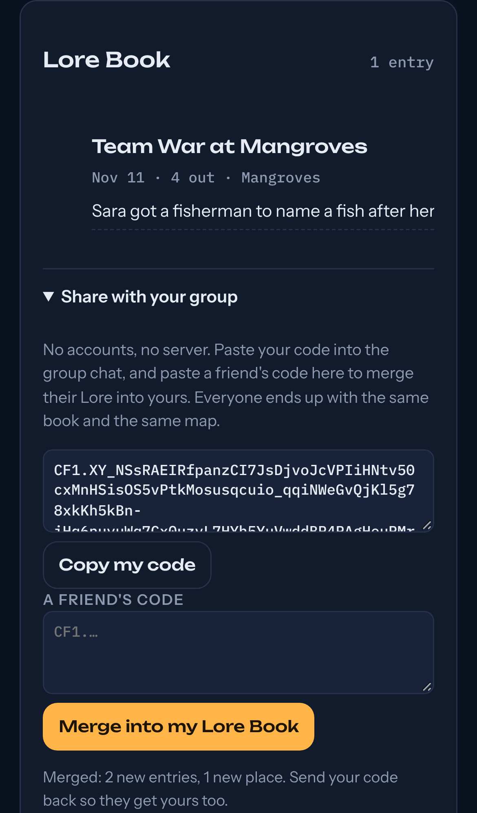

# Lore

A sidequest generator for friend hangouts in Abu Dhabi. Tell it how many people are out, when you have to be home and what you can spend. It picks a niche spot, gives you the real bus route there and back, and hands you a game to play when you arrive. Finished quests clear the fog on a map of your own city and land in a shared Lore Book.

**Live prototype:** https://claude.ai/artifact/LwNwhfV2J2aWaz7CTd35DH

<p>
  
  
  
</p>

## Why

Most hangouts end up in a mall because nobody knows where else to go, and growing up in one city makes it feel like there's nothing new. Existing "things to do" apps give you a pin on a map. They don't tell you whether a group of students can get there by bus, how long you'd actually have once you arrive, or what to do when you get there.

## What works now

- **Group size (1–8)** changes the fare totals, how many dares get dealt, and which games unlock. Team games need 4 or more.
- **Time window** ("out from" / "home by"). Every quest gets a timeline: bus there, time at the spot, bus home, with today's sunset marked. Spots that don't fit get filtered out.
- **Budget cap per person**, covering bus fare both ways, entry, food and game money.
- **10 verified spots**, each with real ITC bus lines, walking distance, and an optional taxi leg with the fare split per cab.
- **Vibe filter**: sunset, chaos, chill, edge, food.
- **Games:** NPC Dialogue (a deck of harmless stranger dares, one per person), the AED 5 Draft, Split Hunt (4+ people), and Cover Art (an album-cover group photo that becomes the Lore Book entry).
- **Boss Fights:** two-stop runs, for example markets before dusk followed by a 3.5 km walk to dinner.
- **All spots** browser, so you can pick a spot directly instead of rolling.
- **Fog-of-war map** and **Lore Book**, saved in the browser.
- **Shared Lore Book with no server:** copy your sync code into the group chat, and paste a friend's code to merge their entries and cleared map into yours. Built on [Campfire](../campfire), a CRDT that guarantees everyone ends up with the same book.

- **Installable PWA:** add it to your home screen, and it keeps working offline once loaded.

## How it works

`prototype.html` is the single source of truth: one self-contained HTML file with no dependencies apart from Google Fonts. `tools/build.js` wraps it into an installable app in `dist/`, adding a document shell, the web manifest, icons and a service worker. The service worker loads the page network-first so new spots show up, falls back to the cache offline, and caches fonts after their first load.

| Piece | Approach |
|---|---|
| Spot data | A `SPOTS` array: coordinates, route legs, minutes door to door, walking metres, tags, costs |
| Bus fare | Hafilat rule: AED 2 + 5 fils/km, capped at AED 5 per trip |
| Taxi fare | Abu Dhabi metered fare: AED 5 flag fall + AED 1.82/km, AED 12 minimum, 4 people per cab |
| Sunset | NOAA solar equations, computed for Abu Dhabi time |
| Planning | `planQuest` / `planBoss` fit travel and stay into the time window and reject plans under 45 minutes |
| Map | Canvas with an offscreen fog layer, cleared with radial gradients around explored spots |
| Storage | A [Campfire](../campfire) CRDT in `localStorage` (try/catch guarded). Older v1 saves migrate automatically |
| Sharing | Campfire sync codes: compressed, checksummed and validated before merging. Campfire is inlined by `campfire/tools/bundle.js` |

## Data sources

- Routes: Google Maps transit data for ITC buses, pulled 10 Nov 2026, all starting from Abu Dhabi Bus Station (Al Wahda).
- Fares: Abu Dhabi Mobility (admobility.gov.ae).
- Spot details: r/abudhabi, wow-abudhabi.com, digiflow.ae.
- New spots get added by a daily research job that verifies each route before adding it.

Every route currently starts at the bus station, and fares are estimates. Check a route the first time you take it.

## Run it

Open `prototype.html` in any modern browser for the quick version. For the installable app:

```bash
npm run build                    # writes dist/
npx serve dist                   # or any static server; service workers need http(s), not file://
```

Deploying: `netlify.toml` builds and publishes `dist/` as is.

## Tests

```bash
npm install    # playwright
npm test
```

- **Data integrity** for every spot: complete fields, coordinates inside the map, valid bus legs and tags, bosses that point at real spots. This also guards the daily job that adds new spots.
- **Fare and taxi maths** against the published Abu Dhabi rules.
- **Sunset** within 5 minutes of real Abu Dhabi times in June, November and December.
- **Planner:** market closing times, the curfew, and the 45-minute minimum stay.
- **Sharing end to end:** two separate browser profiles. One finishes a quest and shares its code, the other merges it and gets the entry and the cleared map. A damaged code changes nothing.
- **Migration:** an old v1 save keeps its entries, notes and map.
- **PWA end to end:** builds the app, checks the manifest, installs the service worker, cuts the network, reloads, and confirms a quest still renders.

## Roadmap

- [ ] Start from your own location instead of the bus station
- [x] Shared Lore Book across a friend group (no accounts: sync codes)
- [x] Installable PWA for phones
- [ ] Photo upload for Cover Art
- [ ] More cities after Abu Dhabi

## Rules the app follows

- Public, legal spots only. No trespassing and no abandoned buildings.
- Dares never involve filming strangers, because UAE privacy law is strict.

## License

MIT. See [LICENSE](LICENSE).
