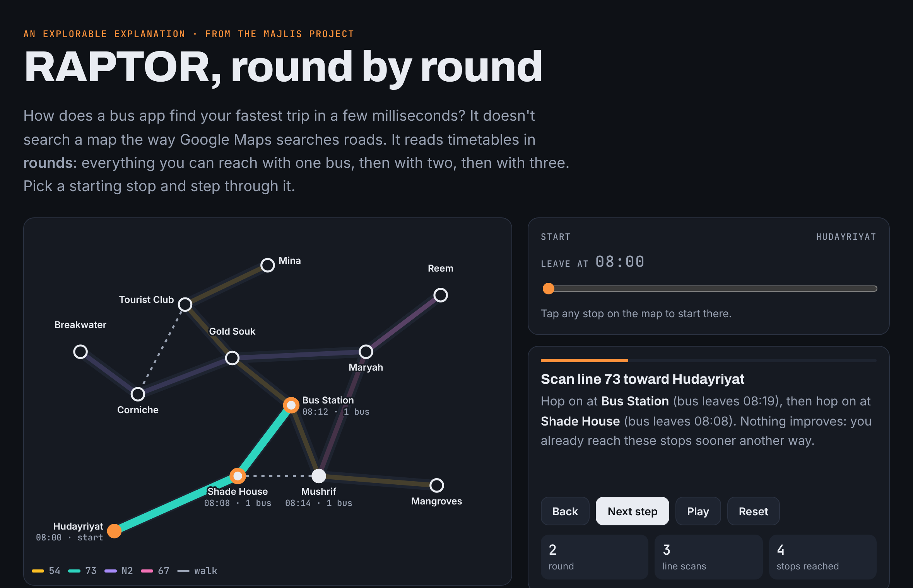

# Majlis

**Find the fairest place for your friends to meet by public transport.**

*Majlis* (مجلس) is the Arabic word for a sitting room where people gather. Give Majlis where everyone is starting from and when they leave. It runs a transit journey planner from each person and ranks meeting places by **the longest trip anyone has to make**. The point is that nobody gets stuck with the 70-minute ride while everyone else takes the bus two stops.

```text
$ majlis --gtfs test/fixtures/tiny --date 20261111 --time 08:05 \
         --person "Ali@24.45,54.30" --person "Eve@24.45,54.342" --top 2

1. Charlie  (longest trip 15 min, total 19 min)
   Ali: 15 min, bus 54 08:10 Bus Station, Al Wahda → Charlie 08:20
   Eve: 4 min, walk the whole way

2. Echo (next to Charlie)  (longest trip 19 min, total 19 min)
   Ali: 19 min, bus 54 08:10 Bus Station, Al Wahda → Charlie 08:20, walk to the place
   Eve: 0 min, walk the whole way
```

## See it work: RAPTOR, round by round

An explorable explanation that runs Majlis's real routing code on a small city. Pick a stop, step through the rounds, and watch each bus line get scanned once, stops light up by how many buses they need, and walks happen only after rides. Then tap any stop to see the journey.

**Live:** https://claude.ai/artifact/XAXpwyvNBP4PGY9mejhmwR · source: [`explainer/`](explainer) (`node explainer/build.js` inlines `src/` so the page and the tests share one implementation)



## Why "fairest" and not "fastest"

The obvious approach is to minimise the group's *total* travel time, and it's quietly unfair. With two friends in the west and one in the east, the total is smallest when everyone meets in the west, so the third friend rides five stops alone. Majlis minimises the **longest** trip (a minimax objective) and uses the total only to break ties. The test suite pins this down: on the same city, `fastest` picks Stop 1 and makes Omar ride 25 minutes, while `fairest` picks Stop 3 and nobody rides more than 15.

## How it works

| Piece | What it does |
|---|---|
| `src/gtfs.js` | Loads any [GTFS](https://gtfs.org/schedule/reference/) feed: quoted CSV, times past midnight, `calendar.txt` plus `calendar_dates.txt` exceptions (e.g. a holiday timetable) |
| `src/timetable.js` | Groups trips into **patterns**: same stops, same order, no overtaking. An express trip that overtakes a local is split into its own pattern, so the FIFO property RAPTOR relies on always holds |
| `src/raptor.js` | **RAPTOR** (Delling, Pajor & Werneck, 2012). Round *k* = best arrival using at most *k* buses. Binary search for the first catchable trip, plus journey reconstruction |
| `src/csa.js` | **Connection Scan** (Dibbelt et al., 2013), an independent second algorithm used only as a test oracle |
| `src/meet.js` | One RAPTOR run per person, then each candidate place is scored by everyone's arrival (nearest stops plus the walk, or walking the whole way when that's faster) |
| `bin/majlis.js` | Command-line interface |

Walking speed is 1.25 m/s with a 1.3 detour factor for real streets. You can walk up to 800 m to or from a stop, and twice that to walk the whole way.

## How it was verified

**Differential testing.** RAPTOR and Connection Scan are different algorithms answering the same question. On 300 randomly generated cities, with 3 queries each, they must agree on the earliest arrival at **every stop**. The random cities include express trips that overtake locals, to stress the pattern splitter.

That test caught two real bugs that the hand-worked tests missed:
1. RAPTOR could **chain two walks**: a bus reached a stop, a walk then reached the same stop sooner, and the transfer step walked onward from the *walking* time.
2. More subtly, both textbook algorithms assume walking transfers are *transitively closed* (if A→B and B→C are listed, so is A→C). Footpaths built from a walking radius aren't, so each algorithm cut a different corner. The fix was to state the rule explicitly (**walk once from your origin and once after each ride**) and to give every stop two times in both algorithms: when a bus can drop you there (walks start only from this) and when you can be there at all (boarding uses this).

**Journey replay.** For 100 random cities, every reconstructed journey to every reachable stop (2,821 journeys) is replayed leg by leg: legs connect, you board after you arrive, never two walks in a row, every walk is a real footpath, and the replay arrives exactly when RAPTOR said.

**Hand-worked feed.** `test/fixtures/tiny` is a 6-stop GTFS feed with answers worked out on paper: missing a bus by a minute, a walking transfer, a quoted stop name with a comma, and a UAE National Day (2 Dec) holiday service that removes a route.

## Performance

`npm run bench` on a random city about the size of a real bus network:

| | |
|---|---|
| Network | 2,025 stops, 604 patterns, 15,400 trips, 291,970 stop times, 276,570 connections (built in 386 ms) |
| RAPTOR, 8 rounds | **2.64 ms** per query (200 queries) |
| Connection Scan | 10.17 ms per query |
| Meeting point, 4 people, every stop as a candidate | 200 ms |
| Machine | Node 22, Intel Xeon 2.1 GHz, 4 cores |

## Use it

```bash
# needs Node 22+, no dependencies
node bin/majlis.js --help
node bin/majlis.js --gtfs test/fixtures/tiny --date 20261111 --time 08:05 \
  --person "Ali@24.45,54.30" --person "Eve@24.45,54.342"
```

**Abu Dhabi data:** the Integrated Transport Centre publishes an official GTFS feed, listed in the Mobility Database as [`mdb-1329`](https://mobilitydatabase.org/feeds/gtfs/mdb-1329). Download and unzip it, then point `--gtfs` at the folder. Add `--place` entries (for example the spots from [Lore](../lore)) to rank specific places instead of every stop.

As a library:

```js
import { loadGtfs } from "majlis/gtfs";
import { meetingPoints } from "majlis";

const city = loadGtfs("./itc-abudhabi", "20261112");
const best = meetingPoints(city, people, { objective: "fairest", top: 3 });
```

## Tests

```bash
npm test
```

20 tests: CSV and time parsing, calendars and holiday exceptions, pattern building, walking transfers, hand-worked arrivals and journeys, the round limit, 900 differential queries, 2,821 journey replays, the fairness objectives, custom places, walk-only trips, the CLI, and the explainer driven in a real browser (skipped if Playwright is not installed).

## Limitations and next steps

- [ ] Run on the official Abu Dhabi feed and publish real results (the sandbox this was built in couldn't reach the download host)
- [ ] Fares: add Hafilat's AED 2 + 5 fils/km so "fairest" can also mean "nobody pays more than AED 5"
- [ ] Arrival spread: today people may arrive at different times; add "everyone arrives within 10 minutes of each other"
- [ ] Spatial index for candidate scoring (currently checks every stop for every candidate)
- [ ] Multi-criteria RAPTOR (fewer transfers vs earlier arrival) and a browser demo for Lore

## References

- D. Delling, T. Pajor, R. F. Werneck. *Round-Based Public Transit Routing.* ALENEX 2012 / Transportation Science 2015.
- J. Dibbelt, T. Pajor, B. Strasser, D. Wagner. *Intriguingly Simple and Fast Transit Routing.* SEA 2013.

## License

MIT. See [LICENSE](LICENSE).
