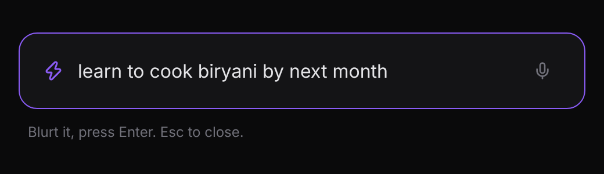
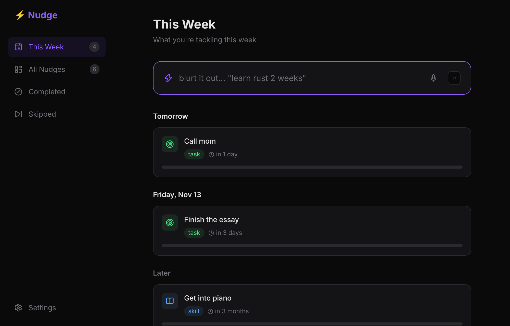
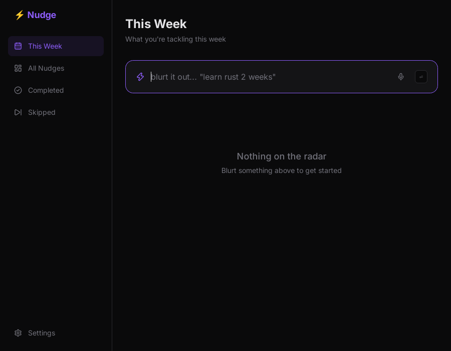

# Nudge

A brain-dump app that lives in your system tray. Press `Ctrl/Cmd + Shift + N` from any app, type whatever you're thinking ("learn rust 2 weeks"), press Enter, and it disappears. Nudge turns the thought into a titled, categorised goal with a deadline, plans it into your week, and checks in at 25%, 50%, 75% and 100% of the time you gave yourself, getting firmer each time.

<p>
  <br>
  
</p>

<p><br><em>The native Tauri build, compiled from this repo and running on Linux.</em></p>

## Why

Ideas, skills to learn and side projects get thought about once and then forgotten. Todo apps are too heavy to open in the moment, and reminders are easy to dismiss. Nudge is built to be the fastest place to put a thought, and the most persistent about following up on it.

## What it does

- **Capture from anywhere:** a global shortcut opens a frameless, always-on-top input. Enter saves, Esc closes.
- **Understands loose input:** "i wanna learn rust in 2 weeks" becomes **Learn rust**, *skill*, due in 14 days. Timeframes use whole-word units, so "buy 3 more eggs" stays a title and is never read as "3 months".
- **Plans your week:** goals are grouped into overdue, each of the next 7 days, and later, each with a progress bar.
- **Check-ins that escalate:** gentle at 25%, firm at 50% and 75%, urgent at the deadline. If your laptop slept through several, you get one nudge, the latest, not a burst.
- **Runs in the background:** closing the window hides it to the tray so nudges keep arriving.

## Architecture

| Layer | Tech |
|---|---|
| Desktop shell | **Tauri 2** (Rust): tray icon, global shortcut plugin, notification plugin, about 10 MB instead of Electron's 150 MB |
| Permissions | Tauri capabilities: windows may only show, hide, focus and send notifications |
| UI | React 19, Vite, Tailwind CSS |
| Logic | `src/lib/parser.js` (blurt to goal), `src/lib/nudges.js` (which check-ins are due), both pure and unit tested |
| Storage | `localStorage`, synced live between the capture popup and the main window via the `storage` event |

The quick-capture popup is the same web app loaded with `?view=capture`, so there's one codebase for both windows.

## Getting started

```bash
npm install
npm run dev            # browser version at http://localhost:1420
npm test               # unit + end-to-end tests (Playwright)
```

Desktop app ([Rust](https://rustup.rs) and the [Tauri prerequisites](https://tauri.app/start/prerequisites/) for your OS):

```bash
npm run tauri dev
npm run tauri build    # installers in src-tauri/target/release/bundle
```

## Tests

17 tests, written test-first. Each parser bug got a failing test before its fix:
- **Parser:** timeframes (minutes to months, "tomorrow", "next week"), numbers that aren't timeframes, filler removal ("i wanna ... in"), whole-word categories ("walk the **dog**" is a habit, not a task because of "do"), and effort.
- **Check-ins:** nothing due early, one due after the last check, only the latest after a long sleep, done and skipped items stay quiet.
- **End to end in Chromium:** a blurt becomes a categorised card, a check-in that came due fires exactly one notification, the This Week count matches the planner, and the capture window shows only the input.

CI (`.github/workflows/ci.yml`) runs the tests, then builds the desktop app on Linux, macOS and Windows.

## Roadmap

- [x] Tray icon, capture-only popup and a Tauri 2 build
- [x] Native notifications on the check-in schedule
- [ ] Sync across phone and laptops
- [ ] Use [Idiolect](../idiolect) to normalize slang before parsing
- [ ] Voice capture
- [ ] "Snooze until tonight" and "mark done" actions on the notification itself

## License

MIT. See [LICENSE](LICENSE).
