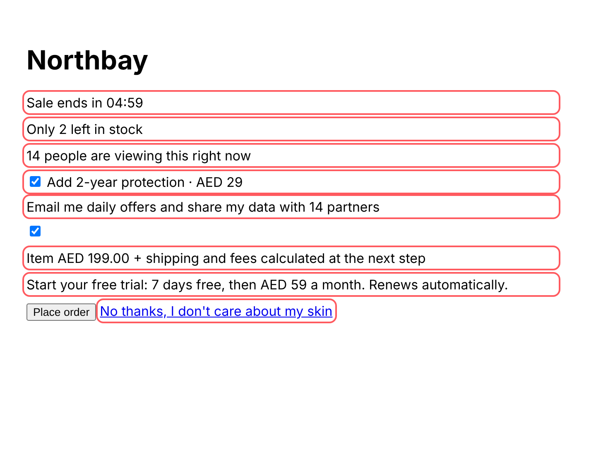
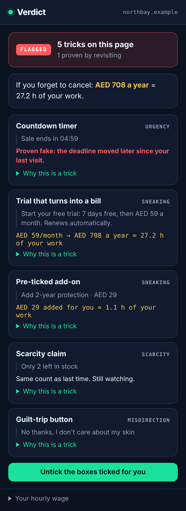

# Verdict

A Chrome extension that catches checkout tricks while you shop, **proves** fake countdown timers instead of guessing, and shows what a purchase really costs you in hours of work. Built for a financial-literacy club.

<p>
  
  
</p>

## Why

Princeton researchers crawled 11,000 shopping sites and found deceptive patterns on about 1 in 10, including countdown timers that reset every time the page reloads and low-stock messages that never change (Mathur et al., CSCW 2019). In a separate experiment with 1,963 people, mild dark patterns more than doubled how many accepted a dubious paid plan, from 11.3% to 25.4% (Luguri & Strahilevitz, 2021).

Other detectors guess from wording, and some send page text to a server to classify it. Verdict runs entirely in your browser and **checks claims over time**, the test those researchers recommend.

## What it catches

| Trick | How Verdict detects it | How it verifies |
|---|---|---|
| Countdown timer | Time pattern next to urgency words, excluding store hours and clock times | Saves the implied deadline. If the deadline moves later when you come back, it is **proven fake** |
| Scarcity claim | "Only 2 left", "14 people viewing", "selling fast" | Saves the stock count and flags it if it is identical a full day later |
| Fees held back | Shipping/fees "calculated at the next step" | – |
| Trial trap | Free trial or auto-renew text with a recurring price | Converts it to a yearly cost |
| Pre-ticked add-on | Checked box with a price and add-on wording | One click unticks it |
| Pre-ticked data sharing | Checked box about marketing, partners or data sharing | One click unticks it |
| Guilt-trip button | "No thanks, I don't care about saving money" | – |

Every flag comes with a short lesson explaining the trick, so users learn to spot it without the extension.

## Install (developer mode)

1. Open `chrome://extensions` and turn on **Developer mode**.
2. Click **Load unpacked** and select `verdict/extension`.
3. Visit a checkout page. Tricks get a red outline, and the toolbar badge shows the count.

## How it's built

- **Manifest V3**, no framework, no build step, only the `storage` permission.
- `src/detectors.js`: pure DOM heuristics. It groups text into sentence-sized blocks so "Sale ends in `<b>04:59</b>`" reads as one claim.
- `src/verify.js`: timer-reset and stock-freeze checks, yearly cost, and hours of work. Plain functions with unit tests.
- `src/content.js`: runs the detectors, stores verification records per page in `chrome.storage.local`, and marks elements with `data-verdict`.
- `popup/`: builds every piece of page text with `textContent`, so a hostile page can't inject HTML into the extension.

## Tests

```bash
cd extension
npm install      # playwright
npm test
```

16 tests across three layers:
- **Unit:** timer reset, rounding drift, stock freeze, price and period parsing
- **Browser:** detectors on a shop with seven tricks and on an honest shop full of near-misses (store hours, "Remember me", a plain "No thanks") that must produce **zero** flags. Also popup rendering and an HTML-injection check
- **End to end:** loads the real unpacked extension into Chromium, visits a live page, reloads it, and confirms the timer is proven fake

## Also in this folder

`demo.html` is a no-install interactive demo with two fake shops and a switch that reveals each trick. Live: https://claude.ai/artifact/SreKDLXgPY81yz7Q7bYefY

## Roadmap

- [ ] Price history for a "was AED 299" check
- [ ] Firefox build (WebExtensions)
- [ ] Club field test: how many tricks members hit in a month, and money saved

## Privacy

Verdict reads the pages you visit locally and stores only timer deadlines and stock counts, keyed by page address, on your device. Nothing is sent anywhere.

## License

MIT. See [LICENSE](LICENSE).
